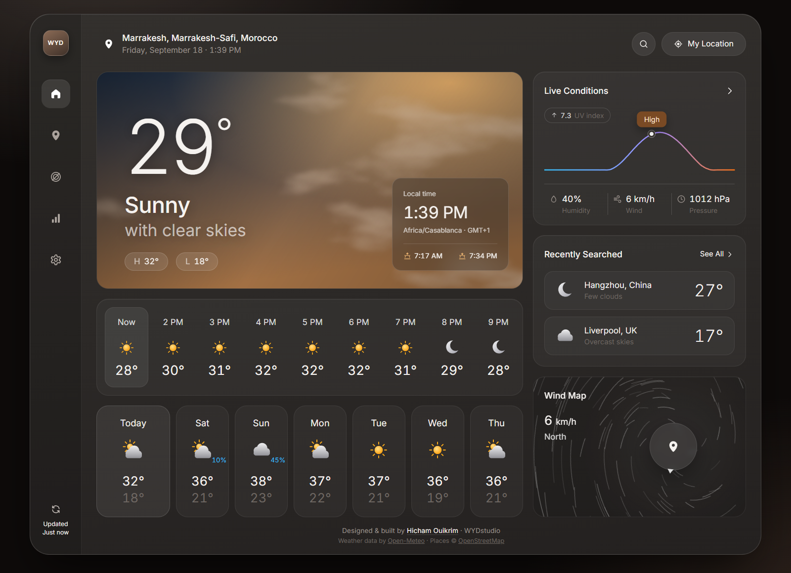
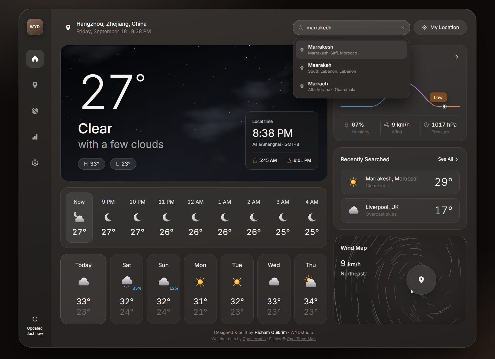
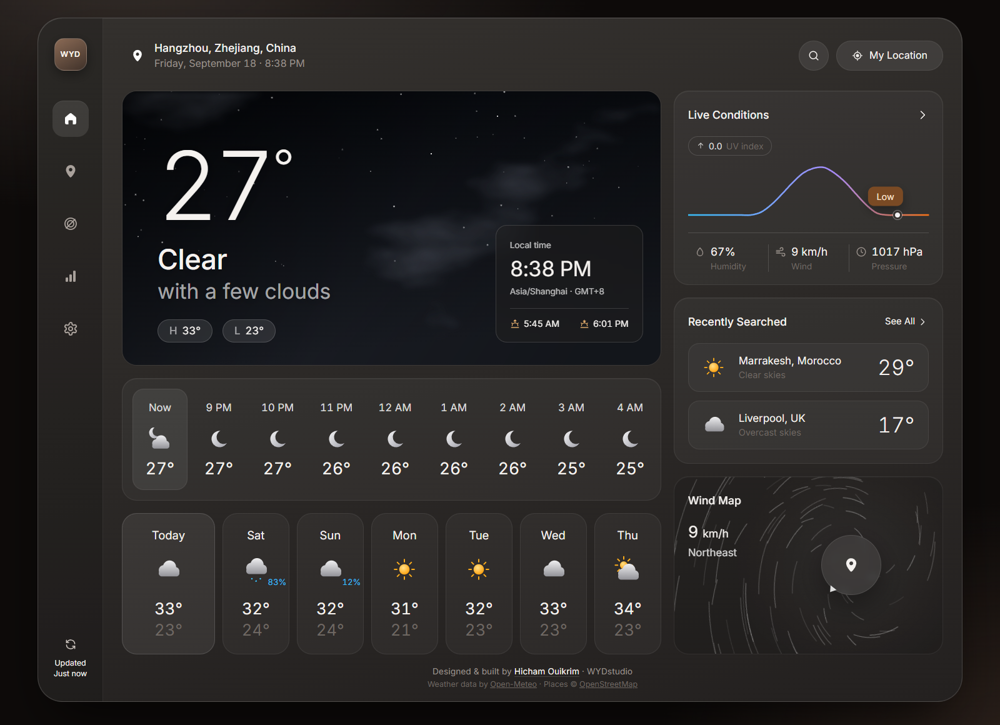
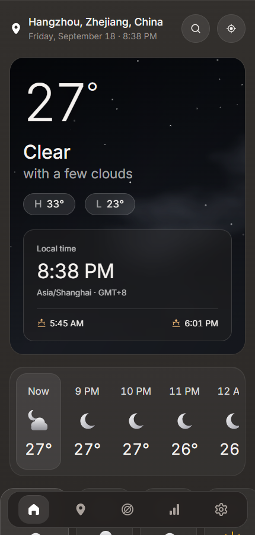

# Weather Dashboard

A weather forecast dashboard built with React and Vite. It shows current conditions, the next 24 hours and a 7-day outlook for any city in the world, with every panel driven by live data — no mock content, no API key required.

**[▶ Open the live demo](https://hicham-om.github.io/weather-dashboard/)**



---

## What it does

- **Find any city.** Two geocoders (Open-Meteo and Photon/OpenStreetMap) are queried in parallel and their results merged, so partial and alternate spellings both work — typing `hang` suggests Hangzhou, and `marrakech` finds Marrakesh. Suggestions appear as each source answers, real cities rank above hamlets, and duplicates are removed.
- **Shows each city's own time.** A live clock in the city's time zone, plus its local date, sunrise and sunset. Hourly times belong to the city, not to the viewer's computer.
- **Current conditions.** Temperature, feels-like, humidity, wind, pressure and today's high and low.
- **Hourly and daily forecasts.** A scrollable 24-hour strip and seven day tiles; picking a day loads that day's hours.
- **Live Conditions chart.** Today's UV index as a curve with the current hour marked and an exposure level; the arrow switches it to temperature or chance of rain.
- **Wind map.** Wind speed and direction with a swirl that turns faster in stronger wind.
- **Recently searched.** Your last cities with their current weather, fetched for all of them in a single request.
- **Generated skies.** The hero background is drawn in the browser with SVG filters — fractal noise shaped into clouds and lit from above — and changes with the weather and time of day. No stock photos.
- **Your location.** One button for the browser's geolocation, with the coordinates turned back into a place name.
- **Units and preferences.** °C/°F, four wind units, and your last city remembered between visits.
- **Works on phones.** The sidebar becomes a bottom bar and the panels stack; tested at desktop, tablet and phone widths.

## Screenshots

| Search suggestions | Night sky |
| --- | --- |
|  |  |

<p align="center">
  
</p>

## Built with

- **React 19** and **Vite 7** — no UI framework, no component library
- **Plain CSS** — custom properties, grid and flexbox, ~1200 lines
- **SVG** — the weather icons, cloud backgrounds, chart and wind map are all hand-written
- **[Open-Meteo](https://open-meteo.com/)** for forecasts and **[Photon](https://photon.komoot.io/)** for place search — both free, both keyless

## Running it

```bash
npm install
npm run dev      # http://localhost:5173
```

```bash
npm run build    # production build in dist/
npm run preview  # serve that build locally
```

Node 20 or newer.

## How it fits together

```
src/
  App.jsx               dashboard state: place, units, selected day, refresh
  components/
    Sidebar.jsx         navigation, settings popover, last-updated
    SearchBox.jsx       city search: debounce, merge, keyboard navigation
    HeroCard.jsx        temperature, condition and the city clock
    SkyBackdrop.jsx     the generated cloud background
    HourlyStrip.jsx     24-hour forecast
    DailyTiles.jsx      7-day forecast
    LiveConditions.jsx  UV / temperature / rain chart
    RecentSearches.jsx  recent cities with live conditions
    WindMap.jsx         wind speed, direction and swirl
    WeatherIcon.jsx     SVG weather icon set
    Icons.jsx           interface icons
  lib/
    api.js              Open-Meteo + Photon requests and result merging
    weather.js          weather codes, formatting, time-zone handling
    storage.js          saved preferences
    useNow.js           ticking clock
```

## Credits

Interface design adapted from [Weather Forecast IOT Dashboard](https://dribbble.com/shots/27365243-Weather-Forecast-IOT-Dashboard) by Noman for Design Monks LLC. Weather data by [Open-Meteo](https://open-meteo.com/). Place data © [OpenStreetMap](https://www.openstreetmap.org/copyright) contributors.

## License

[MIT](LICENSE) — © 2026 Hicham Ouikrim

---

**Designed & built by [Hicham Ouikrim](https://github.com/Hicham-om) · WYDstudio**
